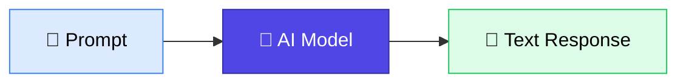

## What is Vercel AI SDK?

The **Vercel AI SDK** is a TypeScript library for building AI-powered applications. It works with multiple AI providers and makes it easy to integrate AI into your apps.

<Card title="AI SDK Documentation" icon="robot" href="https://ai-sdk.dev">
  Official documentation for the Vercel AI SDK
</Card>

The simplest way to use AI is generating text. Let's start here!

